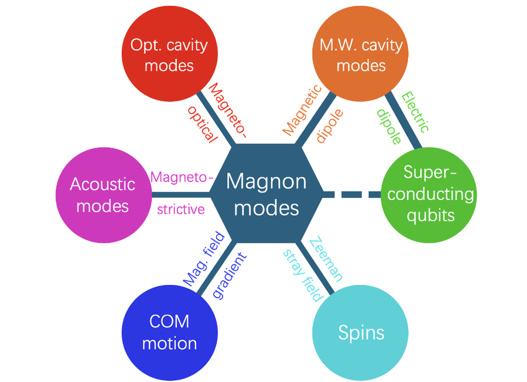

# 网站维护教程（无需借助 AI）

这份文档写给**未来的你自己**。只要会用记事本和一条命令，就能独立更新网站。

- 网站地址：https://gangliuphys.github.io/
- 项目文件夹：`E:\OneDrive - stu.wzu.edu.cn\个人主页`
- 代码仓库：https://github.com/gangliuphys/gangliuphys.github.io

---

## 目录

1. [五分钟快速上手](#五分钟快速上手)
2. [文件结构说明](#文件结构说明)
3. [日常更新：推送改动](#日常更新推送改动)
4. [各板块怎么改](#各板块怎么改)
5. [图片处理](#图片处理)
6. [常见问题排查](#常见问题排查)
7. [部署原理](#部署原理)

---

## 五分钟快速上手

以后每次更新，只要三步：

**第一步**：改文件（用记事本、VS Code 都行）

```
E:\OneDrive - stu.wzu.edu.cn\个人主页\index.html
```

**第二步**：在该文件夹空白处按住 **Shift + 鼠标右键** → 选「在此处打开 PowerShell 窗口」

**第三步**：依次执行这三条命令

```powershell
git add -A
git commit -m "update: 随便写句说明"
git push
```

看到 `main -> main` 就成功了。**等待 1–2 分钟**，访问 https://gangliuphys.github.io/ 就能看到新内容。

> 推送时如果弹出登录框：用户名填 `gangliuphys`，密码粘贴你的 GitHub Token
> （不是登录密码。Token 在 https://github.com/settings/tokens 生成，勾 `repo` 权限）

---

## 文件结构说明

```
个人主页/
├── index.html              ← 主页面，绝大多数修改都在这里
├── assets/
│   ├── css/style.css       ← 样式（颜色、字号、间距、布局）
│   ├── js/site.js          ← 交互逻辑（语言切换、深色模式、搜索、弹窗）
│   └── img/
│       ├── profile.png     ← 你的头像
│       ├── papers/         ← 精选论文配图 paper-01 ~ paper-07.png
│       ├── gallery/        ← 相册照片
│       ├── projects/       ← 项目配图
│       └── favicon.svg     ← 浏览器标签页图标
├── robots.txt              ← 搜索引擎配置
├── sitemap.xml             ← 站点地图
├── .nojekyll               ← GitHub Pages 必需，不要删
├── DEPLOY.md               ← 部署说明
└── .gitignore              ← 告诉 Git 哪些文件不用传
```

**只改前三个文件就够了**：`index.html`、`style.css`、`site.js`。

---

## 日常更新：推送改动

### 命令详解

```powershell
cd "E:/OneDrive - stu.wzu.edu.cn/个人主页"   # 进入项目目录

git add -A            # 把所有改动标记为「准备提交」
git commit -m "说明"   # 提交这次改动，写清楚改了什么
git push              # 上传到 GitHub，网站随即更新
```

`git commit -m` 后面引号里的说明建议写成这样，方便日后回溯：

| 改动类型 | 示例 |
|---|---|
| 新增论文 | `update: 新增 2026.11 PRA 论文一篇` |
| 更新动态 | `update: 补充 2026.09 学术报告动态` |
| 换照片 | `update: 更换相册照片，补充 2026.08 会议合影` |
| 改样式 | `update: 研究项目改为单行显示` |
| 修链接 | `fix: 修正个人主页链接` |

### 只想撤回某次改动

```powershell
git log --oneline -5                  # 查看最近 5 次提交
git revert <commit号>                # 撤销指定提交，比如 8e60127
git push
```

### 改之前先备份

```powershell
Copy-Item index.html index_备份.html
```

---

## 各板块怎么改

所有板块都在 `index.html` 里，搜索中文标题就能定位。

### 新闻动态

搜索 `news__list`，每条动态长这样：

```html
<article class="news__item">
  <p class="news__date">2026.10</p>
  <p class="news__text">
    <span class="lang-only" lang="zh">中文内容</span>
    <span class="lang-only" lang="en">English content</span>
  </p>
</article>
```

**要点**：
- 日期格式 `YYYY.MM`，**新的放最前面**（倒序排列）
- 中文放 `lang="zh"`，英文放 `lang="en"`，两段都要写
- 论文题目用 `<em>` 包起来变成斜体，期刊名不要斜体
- 期刊链接要覆盖完整卷期页码，例如：
  `&lt;a href="..."&gt;Physical Review A 114, 043707 (2026)&lt;/a&gt;`

新增一条：复制整个 `<article>` 块，粘贴到列表最前面，改日期和文字即可。

### 精选论文

搜索 `class="pubs"`。每篇论文：

```html
<article class="pub">
  <a class="pub__link" href="论文链接" target="_blank" ...>
    
  </a>
  <h3 class="pub__title">
    <span>第一作者 姓, 名</span><sup>*</sup>, <strong>你的名字</strong><sup>†</sup>
  </h3>
  <p class="pub__highlight">中文摘要</p>
  <p class="pub__meta">期刊 · 卷, 页码 (年份)</p>
</article>
```

**作者标注**：
- `<strong>你的名字</strong>` = 加粗突出你自己
- `<sup>*</sup>` = 共同第一作者
- `<sup>†</sup>` = 通讯作者

### 全部论文（弹窗里的列表）

搜索 `class="reflist"`。这是简历式完整列表，**序号自动生成，不要手写**：

```html
<li class="refitem">
  <p class="refitem__authors">作者列表</p>
  <p class="refitem__title"><a href="链接">论文标题</a></p>
  <p class="refitem__venue">
    <a href="链接">Phys. Rev. A 114, 043707 (2026)</a>
  </p>
</li>
```

**关键**：列表按**时间倒序**排列（最新的在上），但**序号是从最早的开始数**（2019 年那篇是 `[1]`）。序号由 CSS 自动处理，你只要按时间从新到旧排列即可。

### 研究项目

搜索 `class="grants"`：

```html
<li class="grant">
  <p class="grant__title" data-zh="中文题目" data-en="English Title">中文题目</p>
  <p class="grant__meta">
    <span class="grant__no" data-zh="类别 · 批号" data-en="Category · Number">类别 · 批号</span>
    <span class="grant__time">2027.01 – 2029.12</span>
    <span class="grant__role grant__role--pi" data-zh="主持" data-en="PI">主持</span>
  </p>
</li>
```

**要点**：
- 每条显示为一行：左边题目，右边「类别·批号 + 时间 + 角色」
- `data-zh` / `data-en` 是中英文切换用的，两个都要写
- 角色是「主持」时加 `grant__role--pi` 类（绿色高亮）
- 序号自动生成

### 教育背景 / 工作经历

搜索 `timeline--edu`，每段经历：

```html
<article class="tl-item">
  <p class="tl-when">2020.09 – 2024.06</p>
  <div class="tl-what">
    <h3 class="tl-degree" data-zh="理学博士" data-en="Ph.D.">理学博士</h3>
    <p class="tl-org">
      <a href="学校网址">兰州大学</a>
      <span data-zh=" · 学院 · 专业 · 课题组"
            data-en=" · School · Major · Group"> · 学院 · 专业 · 课题组</span>
    </p>
    <p class="tl-note">          <!-- 研究方向，可选，没有就删掉整个 p -->
      <span class="tl-note-label" data-zh-text="研究方向：" data-en-text="Research:">研究方向：</span>
      <span data-zh="中文方向" data-en="English">中文方向</span>
    </p>
  </div>
</article>
```

### 相册

搜索 `class="gallery"`：

```html
<figure class="shot">
  
  <figcaption><span class="shot__date">2026.10</span> 照片说明文字</figcaption>
</figure>
```

**要点**：
- **照片按时间倒序排列，最新的放最前面**
- 说明文字格式：`日期 + 描述`，例如 `2026.08 与熊伟课题组合影`
- 新照片先放到 `assets/img/gallery/` 文件夹，命名用数字即可（见下节）

### 样式调整

改 `assets/css/style.css`。最常改的几个位置：

| 想改什么 | 找哪里 |
|---|---|
| 全站字号 | 文件开头 `:root` 里的 `--fs-base` 等变量 |
| 内容区宽度 | `--container`（当前 1410px） |
| 左右页边距 | 改 `--container`（越大页边距越小） |
| 主色调 | `--brand-600` / `--accent` |
| 平板/手机断点 | 文件末尾 `@media (max-width: ...)` |

改完记得同时更新中英文用词：搜 `data-en="` 看英文版叫什么。

---

## 图片处理

### 重要：大照片必须压缩

手机照片动辄 3–5MB，直接传会让网页打开很慢。**上传前务必压缩**。

#### 方法一：在线工具（最简单）

1. 打开 https://squoosh.app
2. 拖入图片
3. 右栏设置：格式 JPEG、质量 75–82
4. 点右下角下载

#### 方法二：Windows 自带

1. 右键图片 → 打开方式 → 画图
2. 上方「大小」→「像素」改成宽度 1400（高度会自动按比例缩放）
3. 文件 → 另存为 → 选 JPEG

#### 建议参数

| 用途 | 宽度 | 格式 | 单张大小 |
|---|---|---|---|
| 相册照片 | 1400px | JPEG | 200–400KB |
| 论文配图 | 900px | PNG | 100–300KB |
| 头像 | 800px | PNG | 100KB 内 |

### 论文配图命名

`assets/img/papers/` 下的图片按顺序命名：`paper-01.png`、`paper-02.png`……
序号对应精选论文从上到下的顺序。换图时保持文件名不变，直接覆盖即可。

### 相册照片命名

`assets/img/gallery/` 下随意命名，建议用数字（`1.jpg`、`8.jpg`…），因为 `index.html` 里的路径要对应。

---

## 常见问题排查

### 推送到 GitHub 报错

| 报错 | 原因 | 解决办法 |
|---|---|---|
| `Authentication failed` | Token 错了或过期 | 重新生成 Token |
| `could not find remote repository` | 远程地址不对 | 执行 `git remote -v` 检查，应为 `gangliuphys/gangliuphys.github.io.git` |
| `Updates were rejected` | 远程有你没拉取的改动 | 执行 `git pull origin main` 后再 push |
| `CONNECT tunnel failed` | 网络代理拦截 | 换个网络（手机热点通常可以） |
| `Please tell me who you are` | 未配置身份 | 执行下面两条 |

```powershell
git config user.name "Gang Liu"
git config user.email "gangliuphys@gmail.com"
```

### 改完没生效

1. **强制刷新**：按 `Ctrl + F5`（普通刷新可能读缓存）
2. **等 1–2 分钟**：GitHub 有 CDN 缓存
3. **确认推送成功**：执行 `git status`，看到 `nothing to commit, working tree clean` 说明已提交

### 图片显示不出来

1. 检查文件名是否一致（`1.jpg` 和 `1.JPG` 在部分系统上不同）
2. 检查路径：`assets/img/gallery/8.jpg` 不能写成 `./assets/...`
3. 检查图片是否真的在那个文件夹里

### 排版乱了

多半是标签没配对。检查最近改的地方，`</div>` 和 `<div>` 要数量对应。

### 想全部重来

```powershell
cd "E:/OneDrive - stu.wzu.edu.cn/个人主页"
git log --oneline              # 找到出问题的那次提交号
git revert <提交号>
git push
```

### 重置到某个正常版本

```powershell
git log --oneline                              # 找到正常的提交号
git reset --hard <提交号>                       # 本地回到该版本
git push --force origin main                   # 覆盖远程
```

⚠️ `--force` 会丢弃之后的所有改动，谨慎使用。

### 网络代理挡了 git（推不上去，但网页端能改）

有时公司/校园网代理会拦截 `github.com` 的 git 通道，报错是这两种之一：

```
fatal: unable to access '...': CONNECT tunnel failed, response 502
fatal: unable to access '...': Empty reply from server
```

**判断方法**：浏览器能正常打开 GitHub，但命令行推不上去 → 就是这个问题。

**解决办法 A（推荐）**：换个网络（手机热点通常可以），再执行 `git push`

**解决办法 B**：直接在网页端上传

改单个文件（比如 `index.html`）：

1. 打开 https://github.com/gangliuphys/gangliuphys.github.io
2. 点 `index.html` → 右上角铅笔图标 → 修改
3. 底部填提交说明，**勾选 "Commit directly to the main branch"**
4. 点 Commit changes

上传图片：

1. 进 `assets` → `img` → `gallery` 文件夹
2. 点右上角 `Add file` → `Upload files`，把照片拖进去
3. 同样要**勾选 "Commit directly to the main branch"**，然后提交

> 网页端适合改单个文件；一次要传很多文件时，还是换网络用命令行更省事。

---

## 部署原理（了解即可）

```
你改文件  →  git push  →  GitHub 服务器  →  GitHub Pages 自动发布  →  访客看到
```

- `git push` 只是把文件上传到 GitHub
- GitHub Pages 检测到 `main` 分支有更新，自动重新构建网站
- 整个过程约 1–2 分钟，无需额外操作

**Pages 设置只做一次**：仓库 Settings → Pages → Source 选 `main` / `(root)` → Save

---

## 快速命令速查

```powershell
# 进入项目
cd "E:/OneDrive - stu.wzu.edu.cn/个人主页"

# 日常更新三连
git add -A
git commit -m "update: 说明"
git push

# 查看状态
git status

# 查看最近提交
git log --oneline -10

# 撤销未提交的改动（慎用）
git checkout -- index.html

# 撤销上一次提交（已推送的需再加 git push）
git reset --HEAD~1
git push
```

---

## 建议

- **改大动作前先备份**：把整个文件夹复制一份，改名加日期
- **commit 说明写清楚**：半年后你会感谢自己
- **不确定就先用浏览器预览**：双击 `index.html` 就能看效果，不用等推送
- **GitHub 网页端也能改**：https://github.com/gangliuphys/gangliuphys.github.io
  找到文件点铅笔图标直接编辑，提交时勾选 "commit directly to main branch"
